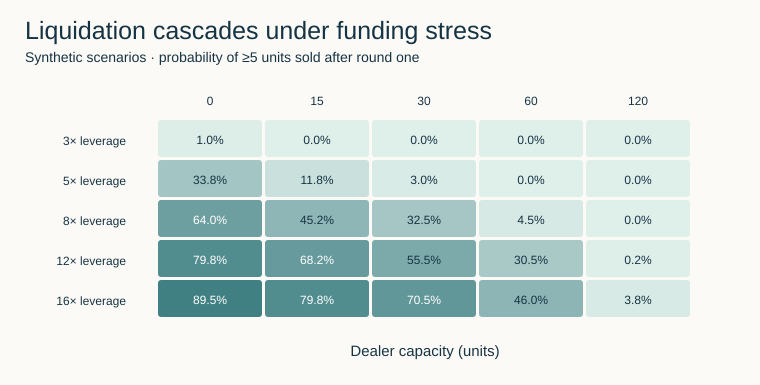

# Treasury fire-sale simulation

In 400 synthetic funding shocks at 8× leverage, cascades occurred in **32.5%** of runs with 30 units of dealer capacity, versus **64.0%** with zero capacity and **0 of 400** with unlimited capacity. A cascade means at least five units sold after the first liquidation round.



## Reproduce

Use Python 3.11 or newer. No Python packages are required for the main run.

```sh
git clone https://github.com/NeilMeher/treasury-fire-sale.git
cd treasury-fire-sale
python -m unittest -v
python study.py --quick --output pilot
python study.py
```

The full run rebuilds the [grid](report/grid.csv), heatmap and [per-step ledger](report/ledger.csv). Open `report/replay.html` and move the round slider to inspect the balances. The [replication notebook](replication.ipynb) uses the same code and seed to vary the price-impact coefficient and dealer capacity. Open it with a Python 3 Jupyter kernel in the repository directory.

See the [protocol](PROTOCOL.md), [results](RESULTS.md), [data register](SOURCES.md), and [experiment log](EXPERIMENT.md). Neil Meher commissioned the work and set review requirements. Codex designed the numerical implementation, simulated the scenarios, and ran the checks. Neil’s review is pending.
